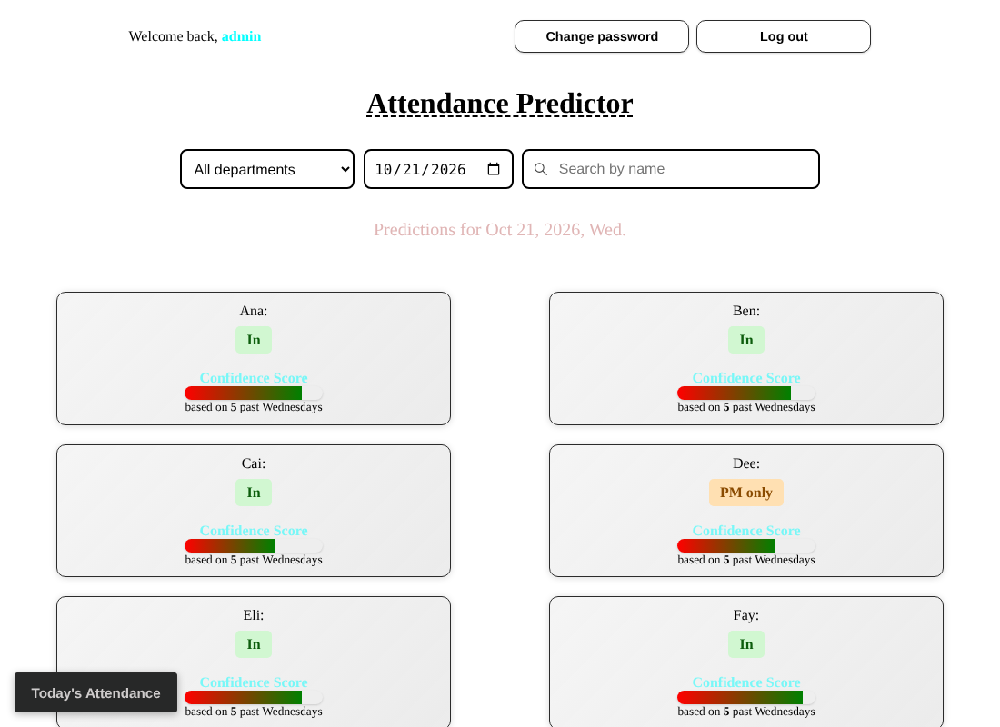
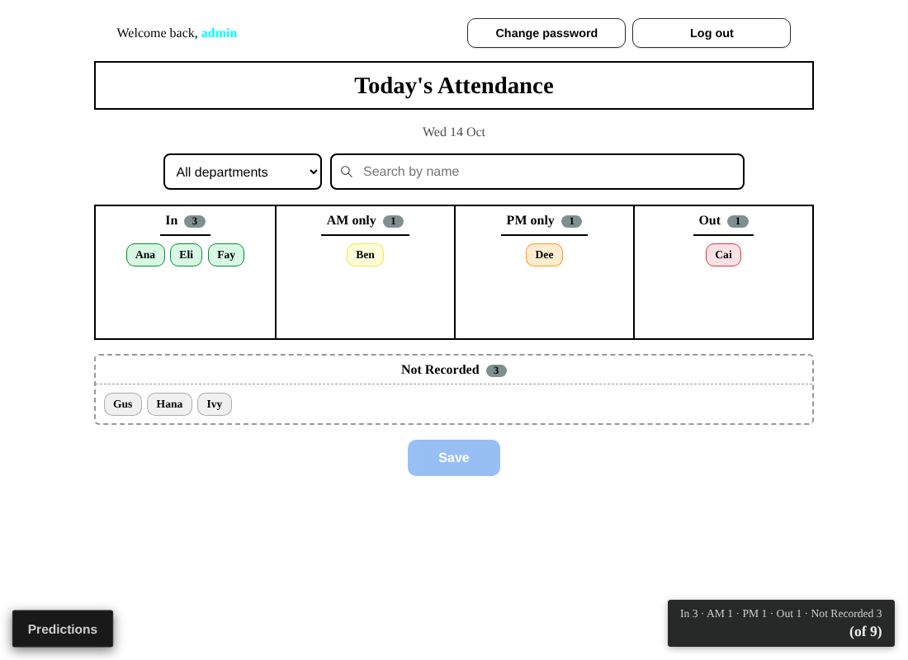
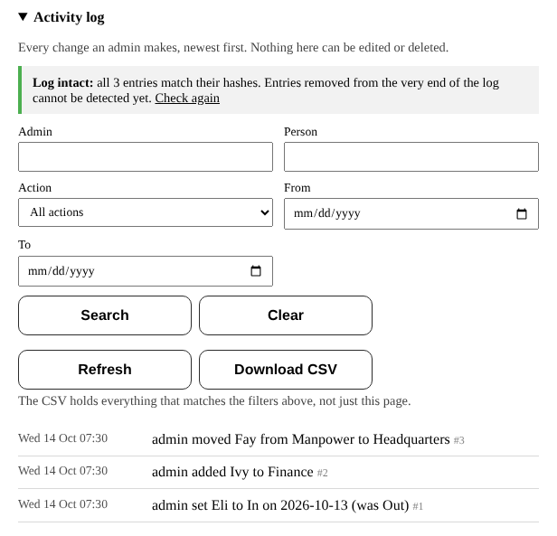

# Attendance Predictor (v1.0)

A small full-stack app that tracks weekday attendance and predicts it from history. Each person gets a **Categorical Naive Bayes** model trained on past **day-of-week → status** patterns. Admins see predictions, confidence scores and holdout accuracy. On the **Today's Attendance** page admins drag names into In / AM (In) / PM (In) / Out, and every other user sets their own status each morning before a cutoff. Admins also record past days, manage people and logins, and download backups. Every admin change goes into a tamper-evident activity log.

**Status:** v1.0, finished for a small team (about 10 admins, 50 accounts) on a **private network** (office LAN or VPN), **not the open internet**. See [Deploying](#deploying-on-a-private-network) and [Known limitations](#known-limitations).







*The screenshots use made-up names.*

## Features

- **Predictions (admin only)** for a future weekday, with a confidence score and sample size per person and an 80/20 holdout evaluation against a simple baseline. They refresh after attendance is saved; other users get `403`.
- **Department filter and name search** on Predictions and on the board (icon buttons on a phone).
- **Today's Attendance** (toggle at the bottom left; non-admins land here): admins drag names on a board, everyone else sets their own status until 08:15 UTC+8, and a tally shows the counts. See [Today's Attendance](#todays-attendance).
- **Four statuses:** In, AM (In), PM (In), Out. See [Statuses](#statuses).
- **People and departments:** add, rename, remove (the person becomes *former* and their history is kept) and restore. Each person has one department; blank means *Holding*.
- **Accounts:** admins create logins singly or in bulk with temporary passwords and link each login to its person. Open sign-up is off by default. See [Accounts and passwords](#accounts-and-passwords).
- **Record attendance** for any past weekday, and **back up / restore** everything as one CSV.
- **Activity log:** who changed what, when, on whom, old and new value, in a hash chain admins can read, filter, verify and download. See [Activity log](#activity-log).
- **Last admin protected:** the server never deletes the only admin (`409`), even if two admins delete each other at once.
- **SQLite** is the source of truth; a CSV can seed it on first run.
- **Tested:** a pytest suite and GitHub Actions CI. See [Tests](#tests).

## Stack

| Layer | Tech |
|-------|------|
| Backend | Python, Flask, Flask-Login, Flask-SQLAlchemy, scikit-learn, pandas, python-dotenv |
| Frontend | React 19, Vite, `@dnd-kit/core` |
| Database | SQLite (`backend/attendance.db`, created locally) |
| Tests | pytest; GitHub Actions runs pytest and `npm run build` |

## Project layout

```
attendance_tracker_app/
├── .github/workflows/ci.yml   # pytest and npm run build on every push
├── backend/
│   ├── app.py               # app factory, API routes, CLI commands, UTC+8 clock, self-service cutoff
│   ├── activity_log.py      # log table, HMAC chain, verify_chain, anchor, append-only triggers, wording, CSV
│   ├── ml.py                # training, prediction, evaluation, model cache
│   ├── backup.py            # backup export and validated restore
│   ├── import_csv.py        # one-time CSV seed
│   ├── users.py             # User, Person, AttendanceRecord models, DEPARTMENTS, STATUSES
│   ├── extensions.py        # db, login_manager
│   ├── requirements.txt / requirements-dev.txt / pytest.ini / .env.example
│   ├── tests/               # one file per area: perms, auth, accs, attendance, selfserve, pplNlinks,
│   │                        #   former, summary, preds, schema, config, lastadm, log_*, backup
│   └── data/sample_attendance.csv   # optional seed data
├── frontend/
│   ├── package.json, .env.example
│   └── src/
│       ├── App.jsx               # shell, login, forced password change, Predictions page, page toggle
│       ├── FilterBar.jsx, icons.jsx
│       ├── DailyAttendance.jsx   # admin board; hands everyone else to MyAttendance.jsx
│       ├── MyAttendance.jsx, AttendanceTally.jsx
│       ├── AttendanceUtils.js    # STATUSES, date and fetch helpers, downloadFromServer
│       ├── AttendanceForm.jsx, PeopleSection.jsx, AccountsSection.jsx, BackupSection.jsx,
│       │   ActivityLogSection.jsx, ActivityLogUtils.js, UserManagement.jsx, ChangePassword.jsx
│       └── *.css
├── documentation/pictures/   # README screenshots
├── LICENSE                   # GPL v3.0
├── todo.txt
└── README.md
```

`attendance.db` and `models.joblib` are generated locally and not committed.

## Prerequisites

- **Python 3.11+** (developed on 3.14; CI runs 3.13)
- **Node.js 20.19+ or 22.12+** (Vite 8; CI runs 22)

## Setup

### 1. Backend

```bash
git clone <your-repo-url>
cd attendance_tracker_app
python -m venv .venv
.venv\Scripts\activate          # Windows; on macOS/Linux: source .venv/bin/activate
cd backend
pip install -r requirements.txt        # or requirements-dev.txt to include the tests
python app.py
```

Always start with `python app.py`: the startup steps below run only there. The database is `backend/attendance.db` whatever directory you launch from. Settings come from environment variables or `backend/.env` (copy `.env.example`); local development needs no changes.

On start the app:

1. Creates missing tables (`user`, `person`, `attendance_record`, `activity_log`).
2. Rebuilds `person` and `attendance_record` from scratch **if they are from an old schema**. This drops their data, so back up first.
3. Rebuilds `attendance_record` if its status rule only allows `0`–`2`, so code `3` is allowed. Every row is kept, and it all happens in one transaction (see [Statuses](#statuses)).
4. Adds missing columns: `person.department` (default *Holding*), `person.former`, `user.person_id` (with its unique index), `user.must_change_password`, `user.requested_department`. Existing logins stay unlinked and are not forced to change passwords.
5. Installs the two `activity_log` triggers that refuse edits and deletes.
6. Seeds from `data/attendance.csv` only if the database is empty and the file exists.
7. Listens on **http://localhost:5000**.

### 2. First admin

Nobody is an admin by default. From `backend/`, run `flask --app app create-admin <username>`; it prompts for a password. Admins create all other accounts in the UI.

### 3. Frontend

```bash
cd frontend
npm install
npm run dev
```

Open **http://localhost:5173**. To use another API address, copy `frontend/.env.example` to `frontend/.env`, set `VITE_API_URL` and restart `npm run dev`.

## Configuration

Plain constants: edit the file and restart the backend. Settings that differ between computers are [environment variables](#environment-variables).

| What | Where | Default |
|------|-------|---------|
| Departments and the blank-means default | `DEPARTMENTS`, `DEFAULT_DEPARTMENT` in `backend/users.py` | Intelligence, Finance, Human Resources, Manpower, Headquarters; *Holding* |
| Office timezone, used for "today", the future-date check and the cutoff | `TIMEZONE_OFFSET_HOURS` in `backend/app.py` | `8` |
| Self-service cutoff (`HH:MM`, local time) | `SELF_SERVICE_CUTOFF` in `backend/app.py` | `"08:15"` |
| Status codes and names, read by the database `CHECK`, API checks, model labels, backup restore and log wording | `STATUSES` in `backend/users.py` | `0` Out, `1` In, `2` AM (In), `3` PM (In) |
| Status names, tooltips, colours and column order in the UI (change with the row above) | `STATUSES` in `frontend/src/AttendanceUtils.js` | |
| Log rows per Activity log page (server allows up to 500) | `PAGE_SIZE` in `frontend/src/ActivityLogSection.jsx` | 50 |
| Password length | `PASSWORD_MIN`, `PASSWORD_MAX` in `backend/app.py` | 8 to 128 |
| Temporary password length; logins per bulk request | `TEMPORARY_PASSWORD_LENGTH`, `BULK_LOGIN_LIMIT` in `backend/app.py` | 12; 200 |
| Records needed for a model / for evaluation | `ml.py` | 5 / 10 |
| Year of the seed CSV | `YEAR` in `backend/import_csv.py` and `backend/ml.py` | `2026` |

Changing the department list does not rewrite existing people: someone whose department was removed keeps it until an admin changes it.

## Statuses

| Code | Name | Meaning |
|------|------|---------|
| `1` | In | There all day |
| `2` | AM (In) | There in the morning, gone for the afternoon |
| `3` | PM (In) | Not there in the morning, there in the afternoon |
| `0` | Out | Not there |

The model predicts one of these four per person, so AM (In) and PM (In) are separate outcomes.

**Upgrading from *Partial Day*:** old code-`2` rows become **AM (In)** when startup step 3 rebuilds the table. Correct any that were really afternoons, and copy `backend/attendance.db` before the first start.

## Data

### Seeding from a CSV (optional)

`backend/data/attendance.csv` is gitignored (real names) and read once, to seed an empty database. Columns:

- `Day`, `Month`, `Day (absolute)`, `Day of Week` (`1` = Mon … `5` = Fri; no weekend rows)
- one column per person, using the status codes (an old sheet's `2` for Partial Day imports as AM (In))

Set `YEAR` in `import_csv.py` and `ml.py` to match. Imported people start in *Holding*; set departments under **People → Departments and logins**. This format covers one year, has no departments and needs every cell filled, so it is **not** the backup format.

### Starting without a CSV

Start empty, build the roster under **People → Add a person**, and record days as they happen. A person needs some history before getting predictions.

### Backup and restore

The database is the only copy of attendance and un-recording deletes permanently, so keep backups.

**Make one** (`attendance-backup-YYYY-MM-DD.csv`): **Backup → Download backup (CSV)** in the app (the un-record warning has a shortcut), or `flask --app app export-backup backup.csv` from `backend/`.

**Format:** header `person,department,date,status,former`, then one row per record, e.g. `Ana,Finance,2026-10-12,1,0`. Dates are ISO; `former` is `1` for removed people and optional when loading. A person with no records gets one row with empty date and status. UTF-8 with a byte-order mark, for Excel. **Logins and links are not included** (no password hashes in a spreadsheet): after a restore, recreate them with **Accounts → Create logins for people** or link existing logins under **People**.

**Restore** (from `backend/`):

```bash
flask --app app import-backup backup.csv              # into an empty database
flask --app app import-backup backup.csv --replace    # replace everything (asks first; --yes skips)
```

The whole file is checked first and every problem is listed with its line number, so a bad file changes nothing. Without `--replace` a non-empty database is refused; `--replace` unlinks every login. The model cache is cleared afterwards. Copy `attendance.db` before a `--replace` too.

**Keep these out of git** (real names): add `attendance-backup-*.csv`, `backup*.csv`, `activity-log-*.csv` and `new-logins-*.csv` to `.gitignore`.

## First use

1. Start backend and frontend, create an admin and log in.
2. **People → Add a person** for everyone to track, each with a department (skip if seeded).
3. Optionally record past days under **Record attendance**.
4. **Accounts → Create logins for people**: tick people, create, and hand out the downloaded usernames and temporary passwords. (Or add logins under **Manage users** and link them under **People → Departments and logins**.)
5. Use **Today's Attendance** (bottom left) to mark today, and **Predictions** to switch back and pick a future weekday.

## Today's Attendance

Always shows **today** in the office timezone (UTC+8). On a weekend it shows only `Sat 17 Oct is a Saturday. No attendance on weekends.`

### Admin board

- Filter by department and search by name. Searching only changes what is shown, never what **Save** sends.
- Drag a name between **In**, **AM (In)**, **PM (In)**, **Out** and **Not Recorded**, with a mouse, by touch (press and hold, then drag) or with the keyboard. Moved names get a dashed outline and the button reads *N unsaved changes*.
- **Save** writes the moves. If it would **delete** records (names dragged back to *Not Recorded*), a red warning lists them first with **Download backup first**, **Cancel** (default; Escape also cancels) and **Remove and save**.
- The page confirms (`Saved attendance for 2 people and removed 1.`) and Predictions refresh.
- The tally at the bottom right follows the department filter (not the search), includes unsaved moves, and shows the total on a larger second line.

### Other users

- **Link first.** An account gets a status of its own only after an admin links it (**People → Departments and logins → Login linked to {name}**), one login per person. Logins from **Accounts → Create logins for people** are linked on creation. Linking is admin-only so nobody can claim someone else's attendance.
- An unlinked account (added under **Manage users**, signed up, or belonging to a removed person) sees `Your account isn't linked to a person…`, no buttons and no head-count (the server answers `403`).
- A linked user sees their name, department, current status and the four status buttons. They may change it **on weekdays until 08:15 (UTC+8)**, overwriting an admin's entry if need be; after that the buttons lock and only an admin can change it.
- The tally shows counts only, defaults to the user's department, can be switched, and refreshes about every 30 seconds.

## Accounts and passwords

- **Bulk (Accounts → Create logins for people):** tick people without a login and press **Create N logins**. Each gets a username from the name (`José Luis` → `jose.luis`, clashes `jose.luis2`), a random 12-character temporary password and a link to its person. The batch is all or nothing. Passwords are shown **once**, with a **Download CSV** (`person,username,temporary_password`).
- **Single (Manage users → Add a user):** the admin types a password; the login is not linked yet.
- **Temporary passwords:** a login made or reset by an admin must choose its own password at once. Until then the server answers `403` with `password_change_required: true` to everything except `/api/login`, `/api/me`, `/api/logout` and `/api/me/password`. The API can skip this rule with `must_change_password: false`.
- **Change password** (top bar, any user): current password required, 8 to 128 characters, different from the current one. The user's other sessions are logged out.
- **Reset password** (Manage users, admin, for someone else): leave blank to generate one, or type one. The user is logged out everywhere; the password is shown once with a **Copy** button.
- **Forgotten admin password:** `flask --app app set-password <username>` from `backend/` (no forced change).
- **Open sign-up** is off (`/api/register` answers `403`, no *Register* button) unless the backend starts with `ALLOW_REGISTRATION=1`. A sign-up creates only an unlinked non-admin login, optionally with a **department request**, which an admin can **Confirm** or **Dismiss** under **Accounts → Sign-up requests** (link the login first).

## Activity log

Each admin change is written to `activity_log` **in the same transaction as the change**. A row holds who (admin id and name, or `system` for server commands), when (UTC+8, e.g. `2026-10-14T11:00:00+08:00`), the action, the person and/or login (ids, and their names at the time), and the old and new value. Names are copies, so rows stay readable after an admin or person is gone.

| Action | Old → new |
|--------|-----------|
| `login_created` (per login in bulk, and `create-admin`) | → `user` or `admin` |
| `login_deleted` | `user` or `admin` → |
| `password_reset` (also `set-password`) | never the password |
| `department_request_confirmed` / `_dismissed` | old department → new / requested department → |
| `person_added` | → department |
| `department_changed`, `person_renamed` | old → new |
| `person_removed` (names the login it unlinked), `person_restored` | |
| `login_linked` / `login_unlinked` | previous person → person / person → |
| `attendance_set` / `attendance_removed` | `2026-10-13 Out` → `2026-10-13 In` / `2026-10-13 In` → |
| `backup_restored` (`import-backup`) | `replaced existing data` → `N people, M attendance records` |

Unchanged saves and failed or refused requests write nothing. **Not logged:** users setting their own attendance or password, sign-up, login/logout, and anything read-only. `tests/test_log_writes.py` fails if a new writing route or command is neither logged nor given a reason. Each row is one fact; the screen groups neighbouring rows (same admin, action and second) only for display.

**The Activity log section (admins)** shows:

- A **chain banner**: *Log intact: all N entries match their hashes*, or a red *The log has been altered* naming the first bad entry. Until an off-server copy of the newest hash exists, it notes that entries removed from the very end cannot be detected.
- **Entries** as plain sentences, newest first, 50 at a time with **Load older entries**.
- **Filters:** admin, person (contains, case-insensitive), action, *From* / *To* (inclusive). **Search** applies, **Clear** resets.
- **Refresh** and **Download CSV** of everything the filters match, oldest first, columns `seq, logged_at, admin, action, text, person, login, old, new, row_hash`. UTF-8 with BOM; cells starting with `=`, `+`, `-`, `@`, tab or carriage return get a leading `'` so a spreadsheet cannot run them as formulas.

**Tamper evidence**

- **Chain:** each row stores the previous hash and its own, an HMAC-SHA256 of every other column keyed with `ACTIVITY_LOG_KEY`. Editing, deleting or inserting a row breaks it, and without the key nobody can rebuild it. Changing the key makes every older row fail, so never change it.
- **Triggers:** two database triggers refuse `UPDATE` and `DELETE`, stopping admins and app bugs (not root, who can read the key).
- **Cut-off rows:** removing the newest rows leaves a valid, shorter chain. `activity_log.anchor()` returns the newest `(seq, hash)` for an off-server copy, and `verify_chain(anchor=...)` checks against it; scheduling that copy is on the [Roadmap](#roadmap).

**From the server** (`flask --app app shell`, in `backend/`):

```python
from activity_log import ActivityLog, verify_chain
print(verify_chain())   # None = intact; a number = the first bad row
print(*[(r.seq, r.logged_at, r.admin_name, r.action, r.person_name, r.login_name, r.old_value, r.new_value) for r in ActivityLog.query.order_by(ActivityLog.seq.desc()).limit(20)], sep="\n")
```

## API (summary)

Everything except register, login and auth options needs a session; browsers must send `credentials: 'include'` (the frontend does). A login with a temporary password may only call endpoints marked †.

| Method | Path | Auth | Description |
|--------|------|------|-------------|
| POST | `/api/register` | No | Unlinked non-admin account: `{username, password, confirmPassword, department?}`. `403` unless `ALLOW_REGISTRATION`. `department` is a request an admin confirms |
| GET | `/api/auth/options` | No | `{registration_open, departments, default_department}` (`departments` empty while sign-up is closed) |
| POST | `/api/login` | No | Start session (cookie) † |
| POST | `/api/logout` | User | End session † |
| GET | `/api/me` | User | `username`, `is_admin`, `must_change_password` † |
| POST | `/api/me/password` | User | `{current_password, new_password}`; ends other sessions † |
| GET | `/api/predict?date=YYYY-MM-DD` | Admin | Predictions for a date |
| GET | `/api/evaluate` | Admin | Holdout accuracy per person |
| GET | `/api/people` | Admin | `[{id, name, department, former, user_id}]`; former people only with `?include_former=1` |
| GET | `/api/departments` | User | `{departments, default}` |
| GET | `/api/today` | User | `{date, weekend, timezone}` in the office timezone |
| GET | `/api/attendance?date=YYYY-MM-DD` | Admin | Recorded statuses for a date |
| PUT | `/api/attendance` | Admin | `{date, records: [{person_id, status}]}` |
| GET | `/api/attendance/summary?department=` | Admin or linked login | Today's head-counts, no names, former people excluded: `{by_status, not_recorded, total}` |
| GET | `/api/me/attendance` | User | Own status today, whether editable, seconds to cutoff, link state |
| PUT | `/api/me/attendance` | User | `{status}` for today |
| GET | `/api/export/attendance.csv` | Admin | Backup file as an uncached download |
| GET | `/api/activity-log` | Admin | `{entries: [{seq, logged_at, admin, action, text, person, login, old, new}], more}`, newest first. Optional `admin`, `person` (contains), `action`, `from`, `to` (`YYYY-MM-DD`, inclusive; bad date `400`), `limit` (1–500, default 100), `before=<seq>` |
| GET | `/api/activity-log/verify` | Admin | `{ok, first_bad_seq, rows, tail_checked}`; `tail_checked` is `false` until an off-server hash copy exists |
| GET | `/api/activity-log.csv` | Admin | Download (`activity-log-YYYY-MM-DD.csv`), same filters, no paging, oldest first, uncached |
| POST | `/api/table_persons` | Admin | `{name, department?}`; a former person's name answers `409` (restore instead) |
| PATCH | `/api/people/<id>` | Admin | `{name?, department?, user_id?, former?}`. `user_id` links a login (`null` unlinks). `former: true` removes (login unlinked and kept; `unlinked_username` says which), `false` restores. A former person cannot be linked. All or nothing |
| GET | `/api/users` | Admin | Accounts (`person_id`, `must_change_password`, `requested_department`) |
| POST | `/api/users` | Admin | `{username, password, is_admin?, must_change_password?}` (last defaults to `true`) |
| POST | `/api/users/bulk` | Admin | `{person_ids}` (up to 200); returns `{created: [{person_id, person, username, temporary_password}]}` once. All or nothing |
| POST | `/api/users/<id>/password` | Admin | `{password?}` (blank generates); returned once; user is logged out everywhere. Not your own account |
| POST | `/api/users/<id>/department-request` | Admin | `{action: "confirm" \| "dismiss"}` |
| DELETE | `/api/users/<id>` | Admin | Not your own (`400`), not the last admin (`409`, "At least one admin is required for app operation.") |

**`PUT /api/attendance`:** weekdays only, not in the future (UTC+8); each `person_id` must exist, be current and appear once; all or nothing. Each `status` is an integer `0`–`3`, or `null` to **remove** that record (which clears the model cache). Response: `{status, date, saved, removed}`.

**`PUT /api/me/attendance`:** the person comes from the admin-made link, never the request. `403` for an unlinked account or after the cutoff; `400` on a weekend.

The UI hides admin sections from non-admins, but the server checks every admin endpoint (`tests/test_perms.py` fails if a route is missing from its table), and every admin endpoint that changes data writes to the [activity log](#activity-log).

## Environment variables

| Variable | Default | Notes |
|----------|---------|--------|
| `DATABASE_URL` | `sqlite:///<backend>/attendance.db` | SQLAlchemy URI |
| `SECRET_KEY` | dev placeholder | Signs sessions. **Required** in production |
| `ACTIVITY_LOG_KEY` | dev placeholder (warning logged) | Keys the log hashes. **Required** in production. Keep it out of git with a safe copy elsewhere, and never change it for an existing database |
| `ENV` | unset | `production` makes the server **refuse to start** without `SECRET_KEY`, `ACTIVITY_LOG_KEY` and `CORS_ORIGIN`, marks the cookie *Secure* and turns debug off |
| `CORS_ORIGIN` | `http://localhost:5173` | The address people open the app at, exactly as the browser shows it (scheme and port, no path or trailing slash); comma-separated for several; `*` refused. **Required** in production |
| `COOKIE_SECURE` | on in production, else off | `1` / `0`. `0` is for plain `http://` on a trusted network (browsers refuse a *Secure* cookie over http); passwords then travel unencrypted |
| `HOST`, `PORT` | `127.0.0.1`, `5000` | For `python app.py`; `HOST=0.0.0.0` exposes it to the network |
| `ALLOW_REGISTRATION` | unset | `1`, `true` or `yes` opens sign-up |

## Deploying on a private network

Keep v1.0 on an office network or VPN that only the right people can reach (see [Known limitations](#known-limitations)). For public use, do [Roadmap](#roadmap) items 2 and 3 first.

1. **Settings files:** copy `backend/.env.example` to `backend/.env` and `frontend/.env.example` to `frontend/.env` (both git-ignored).
2. **Secret keys:** generate `SECRET_KEY` and `ACTIVITY_LOG_KEY` with `python -c "import secrets; print(secrets.token_urlsafe(48))"`, put them in `backend/.env`, and keep copies in a password manager.
3. **Production mode:** set `ENV=production` and `CORS_ORIGIN` to the address people type (e.g. `http://attendance.office:5173`).
4. **Reachability:** set `HOST=0.0.0.0` and open the port in the firewall for the office network only.
5. **HTTPS:** put a reverse proxy (Caddy, nginx) in front, or on a trusted network over plain `http://` set `COOKIE_SECURE=0`.
6. **Frontend:** set `VITE_API_URL` to the backend address, run `npm run build`, and serve `frontend/dist/` with any static server (IIS, nginx, Caddy, `npx serve dist`). That address is the `CORS_ORIGIN`.
7. **First admin and start:** `flask --app app create-admin <username>`, then `python app.py`. The terminal should show no insecure-key warning.
8. **Backups:** the CSV holds people and attendance only. For logins, links and the log, also copy `backend/attendance.db` while nobody is saving (or `sqlite3 attendance.db ".backup 'copy.db'"`), on a schedule, off the server, together with `ACTIVITY_LOG_KEY`.

**Upgrading:** copy `backend/attendance.db`, replace the code, then start once with `python app.py` so the startup steps run.

## How the ML pipeline works

1. **Seed (optional):** on first start only, a wide CSV becomes long rows in `attendance_record`.
2. **Load:** SQL pivoted to one column per person plus `Day of Week`; days without a record are empty.
3. **Train:** one `CategoricalNB` per person on the days they have records; fewer than 5 records means no model yet. Models are cached in `models.joblib`.
4. **Retrain:** when the cache is older than the newest `updated_at` (UTC). A delete leaves that timestamp unchanged, so un-recording and restoring a backup delete the cache instead (`invalidate_models()`).
5. **Predict:** weekday (Mon–Fri) is the only feature. People without a model are left out; a weekend date returns an empty list with a message.
6. **Evaluate:** 80/20 holdout per person against a majority-class baseline; people with fewer than 10 records are skipped.

## Tests

From `backend/`:

```bash
pip install -r requirements-dev.txt
pytest
```

Each test gets its own empty SQLite file, model cache and fixed clock, never touching `attendance.db`. The 753 tests cover:

- permissions on every route (an unlisted route fails the suite)
- accounts: closed sign-up, change and reset password, forced change on every route, bulk logins, department requests
- attendance entry and un-record with model-cache clearing; the 08:15 cutoff and UTC+8 clock at their edges
- people, links, removing, restoring and renaming; the tally; admin-only predictions
- constraints, startup migrations, backup and restore
- the last-admin rule, including two admins deleting each other at once
- the activity log: hashed bytes, chain, triggers, anchor, wording for every action, every route and command writing the right rows (or none when it fails, is refused or changes nothing), and the three log routes

The suite was also checked by breaking the code on purpose (21 bugs in attendance, 6 in accounts, 17 in remove/rename, 16 in the log module, 34 in its wiring, plus the last-admin rule and the log routes); every one was caught. Changes that cannot alter behaviour, such as a missing `rollback()`, are not counted.

**CI** (`.github/workflows/ci.yml`) runs `pytest` (Python 3.13) and `npm ci` + `npm run build` (Node 22) on every push and pull request.

The frontend has no tests yet (the helpers in `ActivityLogUtils.js` are pure and easy to test); `npm run build` checks that it compiles.

## Manual smoke test

For the parts without tests. The API calls are for Windows PowerShell, where `curl` is an alias (use `Invoke-RestMethod` or `curl.exe`).

1. **Start:** the backend starts cleanly and `npm run build` passes.
2. **Admin board:** drag names into each column and back to *Not Recorded*, Save, reload, and confirm the board matches. Un-recording must show the warning; Cancel or Escape must change nothing. Check the tally against the dropdown. In a phone-sized window with touch emulation, hold a chip and drag; the tally must not overlap the toggle button.
3. **Link and self-service:** create a linked login (**Accounts → Create logins for people**), log in with its temporary password, choose your own, change status and check the tally. To test the cutoff, temporarily set `SELF_SERVICE_CUTOFF` to `"23:59"` (open) and `"00:01"` (closed), restart, and **set it back afterwards**.
4. **Un-record and retrain:** open Predictions so `models.joblib` exists, un-record someone, confirm the file is gone, then reappears after reopening Predictions.
5. **Activity log:** rename someone and open **Activity log**: the newest entry must describe it and the banner must say *Log intact*. Filter by that person, **Download CSV**, and check it holds only those rows.
6. **Permissions** (as a non-admin):

```powershell
$body = @{ username = "USER"; password = "PW" } | ConvertTo-Json
Invoke-RestMethod http://localhost:5000/api/login -Method Post -ContentType "application/json" -Body $body -SessionVariable s2
Invoke-RestMethod http://localhost:5000/api/me -WebSession $s2            # is_admin should be False

# expect 403 (admin-only)
try { Invoke-RestMethod "http://localhost:5000/api/attendance?date=2026-10-15" -WebSession $s2 } catch { $_.Exception.Response.StatusCode.value__ }
try { Invoke-RestMethod "http://localhost:5000/api/predict?date=2030-01-07" -WebSession $s2 } catch { $_.Exception.Response.StatusCode.value__ }

# own attendance: 200 before the cutoff if linked, otherwise 403 (message in $_.ErrorDetails.Message)
$b = @{ status = 1 } | ConvertTo-Json
Invoke-RestMethod http://localhost:5000/api/me/attendance -Method Put -ContentType "application/json" -Body $b -WebSession $s2
```

A `401` means the session is not logged in at all, not that the user lacks permission.

## Troubleshooting

**Startup and database**
- **`no such column: ...` or `no such table: activity_log`:** the database predates a schema change and the backend was not started with `python app.py`. Run it once. Changes not in the startup list need manual SQL; `db.create_all()` never alters existing tables.
- **Data "missing":** `flask --app app` and `python app.py` use the same `attendance.db` from any directory; check which file you are looking at.
- **`ModuleNotFoundError: No module named 'activity_log'`:** `backend/activity_log.py` is missing.
- **The server will not start and names `SECRET_KEY`, `ACTIVITY_LOG_KEY` or `CORS_ORIGIN`:** `ENV=production` is set and that setting is missing from `backend/.env`.
- **The server will not start and says `CORS_ORIGIN contains ...` or `COOKIE_SECURE must be 1 or 0`:** fix the value. An origin looks like `https://attendance.example.com` or `http://10.0.0.5:5173`.
- **A `.env` setting has no effect:** the file is `backend/.env` or `frontend/.env`, with no spaces around `=`. A real environment variable beats the file, and the frontend reads its file only when `npm run dev` starts. (`ATTENDANCE_NO_DOTENV=1` switches the backend file off; the tests set it.)

**Browser and network**
- **A CORS error on `/api/predict`** usually hides a 500 (error responses can lack CORS headers). Read the Flask terminal.
- **Requests fail with CORS errors, or the cookie is never set:** the browser address differs from `CORS_ORIGIN` (e.g. Vite picked 5174). Set it to exactly the browser address and restart.
- **With `ENV=production` over plain `http://` you are logged out at once:** the *Secure* cookie needs HTTPS. Use HTTPS or, on a trusted network only, `COOKIE_SECURE=0`.
- **Every call goes to the wrong address:** `VITE_API_URL` is baked in at `npm run dev` / `npm run build`. Fix `frontend/.env` and restart or rebuild.
- **`HTTP 404` on Today's Attendance:** the running backend is older than the page. Replace `app.py` and restart.
- **A blank page** is usually a JavaScript error; check the DevTools console.
- **An import fails on `./AttendanceUtils`:** the file must be exactly `AttendanceUtils.js`. Windows ignores case; Linux, macOS and CI do not. After a rename on Windows, use `git mv` through a temporary name.
- **CI fails with "Some specified paths were not resolved":** `frontend/package-lock.json` is not committed. Run `npm install` in `frontend/` and commit it.

**Accounts**
- **Everyone was logged out after an upgrade:** expected once; the session cookie now carries a password fingerprint.
- **A user is stuck on "Choose your own password":** they enter the temporary password as the current one and choose a new one; an admin can reset it again.
- **The only admin forgot their password:** `flask --app app set-password <username>`.
- **No *Register* button:** sign-up is off; start with `ALLOW_REGISTRATION=1`.
- **"Your account isn't linked to a person yet":** expected for a new login; an admin links it under **People → Departments and logins**.
- **"At least one admin is required for app operation." (`409`):** two admins deleted each other at the same moment and nothing was removed.

**Backups and the log**
- **`import-backup` says "The backup file has problems":** fix the listed lines and retry; nothing was written. Common causes are a date Excel reformatted (must be `YYYY-MM-DD`) and a weekend date.
- **`import-backup` says the database already has people or attendance:** that is the safety check. Use `--replace` only to delete what is there.
- **The Activity log says "Could not check the log" or will not load:** check the Flask terminal (`403` = not an admin, `500` = server error).
- **The Activity log says "The log has been altered":** a row was edited, removed or inserted, or `ACTIVITY_LOG_KEY` differs from the one the rows were written with. Restore the old key; do not rebuild the log.

## Known limitations

- **Private network only:** no CSRF protection, login rate limiting, lockout or 2FA, and `python app.py` is Flask's built-in server.
- **Login timing leak:** `/api/login` answers faster for unknown usernames, so usernames can be guessed from response time.
- **The board is not kept fresh:** with several admins the last save of a day silently wins, and the board neither refreshes nor warns when another admin saves.
- **Log limits:**
  - The newest hash is not copied off the server, so rows cut off the end go unnoticed.
  - The `import-backup` row is written just after the restore commits, so a crash in between leaves the restore unlogged.
  - Root on the server can read `ACTIVITY_LOG_KEY` and rewrite the log.
  - The *From* / *To* filters compare stored times as text, correct while every row carries `+08:00`. Changing `TIMEZONE_OFFSET_HOURS` on a database with rows would shift them.
  - The log CSV guards against spreadsheet formulas; the **backup** CSV cannot (it must restore exactly), so open a backup in a spreadsheet only if you trust every name in it.
- **Un-recording is a permanent delete.** The app warns and offers a backup, but nothing is backed up automatically.
- **The old-schema rebuild (startup step 2) drops `person` and `attendance_record`.** Back up before upgrading an old database.
- **No Alembic migrations:** startup handles only the changes in its list; anything else needs manual SQL or a rebuild.
- **Last-admin rule counts accounts only:** admins cannot be demoted, so deleting is the only way to lose one.
- **People are never deleted:** *Remove* makes someone former and keeps their name reserved (restore or rename them first). Deleting a login just unlinks it.
- **Passwords are reset by an admin only** (no email or self-service reset).
- **Four statuses, no more:** fixed by the `STATUSES` table and a database `CHECK`. Adding one means changing `backend/users.py`, the frontend list, and the tests that spell out the statuses (such as `test_summary.py` and `test_former.py`), which fail until updated, as intended.
- **Small departments:** a head-count for one or two people effectively identifies them.
- **`/api/predict`'s "today or later" check** uses the server's date, not UTC+8.
- **Weekdays only:** weekends cannot be recorded or predicted.

## Roadmap

Planned for v1.x, roughly in this order (details in `todo.txt`):

1. **Stale-board warning** when someone else saved the same day since the board loaded.
2. **A production server and HTTPS:** gunicorn (Linux) or waitress (Windows) behind a reverse proxy, a Dockerfile, SQLite WAL mode, atomic model-cache writes.
3. **CSRF protection and login rate limiting**, which stand between this app and the open internet.
4. **Scheduled backup** including the activity log and an off-server copy of its newest hash (`anchor()`), so the chain check can notice rows cut off the end.
5. **Frontend tests** (Vitest component tests, a few Playwright flows) in CI, plus fixing the 4 lint errors so CI can run `npm run lint`.
6. **More `.env` settings:** timezone offset, cutoff time, department list (validated at startup).
7. Optional 2FA for creating admin accounts.

Later, if ever: Flask-Migrate; a Vite proxy so API and UI share one origin in development; consistent response shapes and blueprints; `/api/predict` using the UTC+8 date.

## Version history

- **v1.0** — Four statuses: *Partial Day* split into *AM (In)* (code 2) and *PM (In)* (code 3), with one `STATUSES` table and an automatic table rebuild at startup. Last-admin protection (`409`, decided under SQLite's write lock). Activity log screen with `GET /api/activity-log`, `/verify` and `.csv`. Deployment settings (`CORS_ORIGIN`, `VITE_API_URL`, `COOKIE_SECURE`, `HOST`, `PORT`, `.env` files, production start checks, debug off in production), a private-network deployment guide, screenshots, GPL v3.0. Tests: 569 → 753.
- **v0.6** — CI and `requirements.txt`. Admin-only predictions, accuracy and people list; department filter and search. Account management: closed sign-up, bulk linked logins, temporary passwords with a server-enforced change, change and reset password, `set-password`. Remove, rename and restore people. Activity log recording with an HMAC chain, append-only triggers, `verify_chain` and `anchor`. Tests: 31 → 569.
- **v0.5** — Backup and restore (CSV download, `export-backup` / `import-backup` with whole-file validation), a warning before un-recording, split admin sections, the pytest suite.
- **v0.4** — Un-record attendance, self-service status until 08:15 UTC+8, login ↔ person links, the tally, a fixed UTC+8 office clock, admin-only `GET`/`PUT /api/attendance`.
- **v0.3** — Today's Attendance page with drag and drop, departments, bottom-left toggle.
- **v0.2** — Predictions and evaluation, in-app attendance entry, people, user accounts, SQLite as the source of truth.

## License

Released under the **GNU General Public License v3.0**; see `LICENSE`.